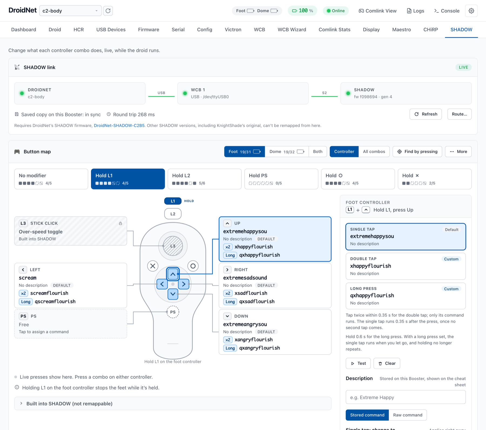
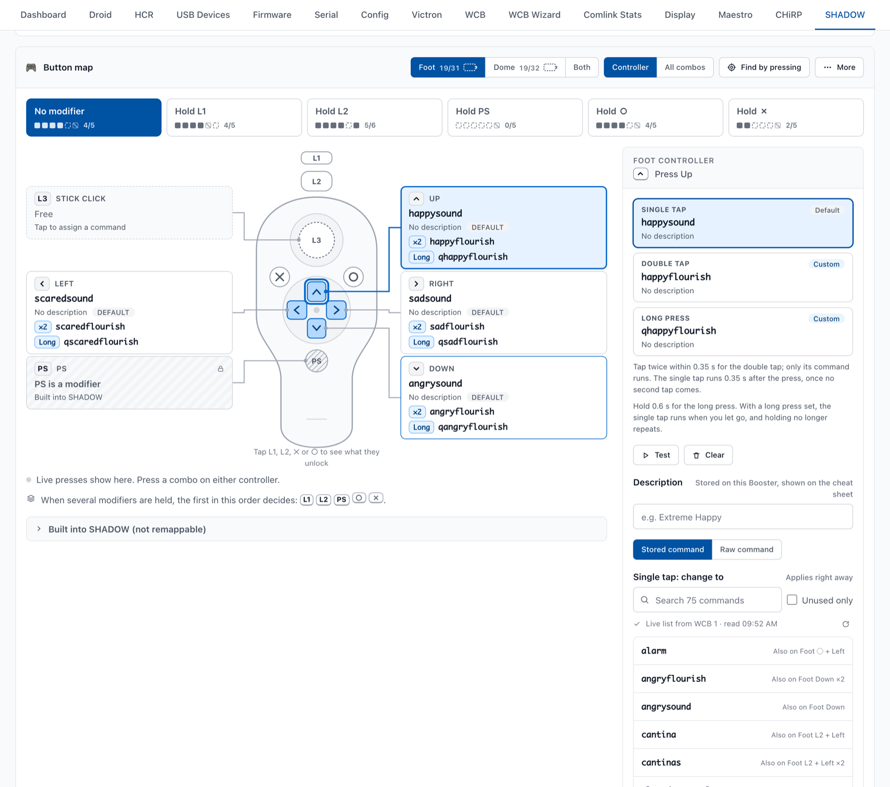
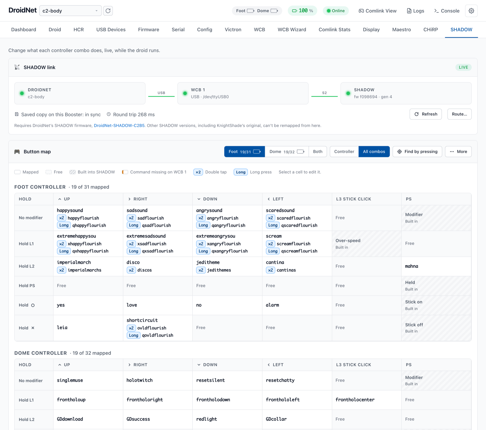
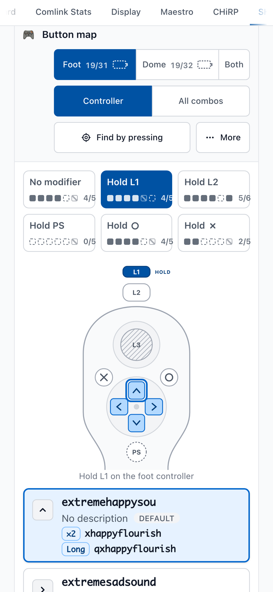

# DroidNet-SHADOW-C2B5

SHADOW firmware for an astromech's main controller (Arduino Mega ADK): PS3 Move Navigation controllers drive the feet and dome, and every other button combination runs a command you pick from DroidNet, live, while the droid runs.

> [!IMPORTANT]
> **This only works with DroidNet and a WCB.** Every button SHADOW handles sends a stored command to a [Wireless Communication Board (WCB)](https://github.com/greghulette/Wireless_Communication_Board-WCB/wiki), and the SHADOW tab in [DroidNet Signal Booster](https://github.com/travisccook/DroidNetSignalBooster-releases) is how you see and change what each button does. Without a WCB the buttons go nowhere, and without DroidNet you're stuck with C2-B5's own button map and stored-command names. Standalone, it does you no good. If you aren't running DroidNet and a WCB, start with the original SHADOW or SHADOW+MD instead.
>
> **It's built for one purpose and one set of parts:** C2-B5's. That means an Arduino Mega ADK, PS3 Move Navigation controllers, a Sabertooth for the feet and a SyRen for the dome (both in packetized serial), and a WCB. This is not a flexible, multi-purpose sketch. There are no settings for other controllers, motor drivers, sound boards or dome systems, so using it with different parts means editing the code yourself.

> [!WARNING]
> **No warranty.** This firmware drives motors on a robot that people stand next to. It's shared as-is, the way the SHADOW community shared with us: it's up to you to wire it, test it and run your droid safely. See [LICENSE](LICENSE).

## The SHADOW tab in DroidNet

These screenshots are from C2-B5's own Signal Booster.



The link line at the top shows DroidNet reaching SHADOW through the WCB. Below it is the button map, one layer per held modifier. Click a combo to change it. The change goes to SHADOW straight away and is kept in its EEPROM, so it survives reboots and firmware uploads. The controllers stay connected the whole time.



**All combos** shows every combo in a table, one controller after the other, which also makes a printable cheat sheet. The tab works on a phone too.





## What it does

- **Drives the droid.** The foot controller's stick drives the feet through a Sabertooth (mixed mode). The dome controller's stick turns the dome through a SyRen. Both have ramping and deadzones, from SHADOW+MD.
- **Turns every other combo into a WCB command.** A button, alone or with a modifier held (L1, L2, PS, ○ or ✕), on either controller, sends a WCB stored command: `;W1;C<key>` by default. Combos can also have a double tap and a long press (all but L3, the stick click), and any of them can be a raw command typed into DroidNet instead.
- **Keeps the map in EEPROM.** DroidNet reads and changes it over the WCB link (SHADOW's `@SM` protocol). The built-in defaults are in [`src/default_mappings.cpp`](src/default_mappings.cpp).
- **Announces itself** to the WCB every 25-30 seconds, so DroidNet can find it.
- **Reports controller batteries** (OK, LOW or CRIT) to DroidNet.
- **Stops the motors** when a controller drops or sends bad data, and accepts only the controllers you've allowed (from DroidNet's Serial tab, or built in).

## What you need

This is the only hardware the firmware supports. Anything different, such as another board, controller or motor driver, needs code changes.

- **Arduino Mega ADK** (Rev3). Its USB host port takes the Bluetooth dongle. The firmware is built for this board (`board = megaADK`).
- **A USB Bluetooth dongle** that the USB Host Shield 2.0 library supports (2.0+EDR). See the library's [list of tested dongles](https://github.com/felis/USB_Host_Shield_2.0/wiki/Bluetooth-dongles).
- **PS3 Move Navigation controllers:** one for the feet, plus an optional one for the dome and optional backups for each.
- **Motor drivers:** a [Sabertooth 2x32](https://www.dimensionengineering.com/products/sabertooth2x32) or 2x25 for the feet and a [SyRen 10](https://www.dimensionengineering.com/products/syren10) for the dome, both in packetized serial.
- **A WCB** running firmware 6.2.1 or later (for the device announce), plugged into the Signal Booster by USB.
- **DroidNet Signal Booster** with the SHADOW tab. Use the newest release: double taps, long presses and raw commands each need a recent one.
- **[PlatformIO](https://platformio.org/platformio-ide)**, only if you build the firmware yourself: VS Code with the PlatformIO extension, or the `pio` command line. This is not an Arduino IDE sketch. To flash a release, DroidNet is all you need.

## Wiring

```
                         Arduino Mega ADK
                    ┌────────────────────────┐
   Bluetooth dongle ┤ USB host port          │
                    │                        │
                    │ TX1 (pin 18) ──────────┼──► WCB S-port RX
                    │ RX1 (pin 19) ◄─────────┼─── WCB S-port TX
                    │ GND ───────────────────┼─── WCB GND
                    │                        │
                    │ TX2 (pin 16) ──────────┼──► Sabertooth S1 and SyRen S1
                    │ GND ───────────────────┼─── Sabertooth 0V and SyRen 0V
                    │                        │
           computer ┤ USB-B (upload, debug)  │
                    └────────────────────────┘
```

| Mega ADK      | Connects to                                  | Notes                                                                                 |
| ------------- | -------------------------------------------- | ------------------------------------------------------------------------------------- |
| TX1, pin 18   | RX of one WCB S-port (S1-S5)                 | Commands to the WCB and replies to DroidNet. 9600 baud.                               |
| RX1, pin 19   | TX of the same S-port                        | DroidNet's mapping requests arrive here.                                              |
| GND           | WCB GND                                      | A common ground is required.                                                          |
| TX2, pin 16   | Sabertooth S1 and SyRen S1, on the same wire | Packetized serial at 9600 baud. Sabertooth is address 128, SyRen 129. RX2 isn't used. |
| GND           | Sabertooth 0V and SyRen 0V                   |                                                                                       |
| USB host port | Bluetooth dongle                             | Also where you plug a controller in to pair it (see below).                           |
| USB-B port    | Your computer                                | Uploading and the 115200-baud debug console. Opening this port resets the Mega.       |

**WCB:** C2-B5 wires SHADOW straight to WCB 1's S2 with those three wires, with no level shifter. On the WCB:

- Leave the S-port at 9600 baud (`?BAUD,Sx,9600`, where `x` is the port number).
- Optionally turn off broadcast output to SHADOW's port (`?BCAST,OUT,Sx,OFF`), since SHADOW ignores mesh broadcasts anyway. See the WCB wiki's [Broadcast](https://github.com/greghulette/Wireless_Communication_Board-WCB/wiki/Broadcast) page.
- Every button runs a stored command on WCB 1 by default. DroidNet can change that prefix (**Route & command format** in the SHADOW tab).

**Motor driver DIP switches**, as SHADOW+MD has always used them:

| Driver                 | Switches                                  | Result                         |
| ---------------------- | ----------------------------------------- | ------------------------------ |
| Sabertooth 2x32 / 2x25 | 1 and 2 OFF (down), all others ON (up)    | Packetized serial, address 128 |
| SyRen 10               | 1, 2 and 4 OFF (down), all others ON (up) | Packetized serial, address 129 |

Check your driver's manual before you power up: on a Sabertooth 2x32, switch 3 also chooses between battery protection (OFF) and power-supply mode (ON). SHADOW+MD also notes that some builders add a 10 kΩ resistor between S1 and 0V on the SyRen 10.

**Power:** run the Mega from its barrel jack or VIN, within [Arduino's limits for the Mega ADK](https://docs.arduino.cc/retired/boards/arduino-mega-adk-rev3/). The motor drivers run from the drive battery, and every ground is common.

## Turn it on

### 1. Put the firmware on SHADOW

**With DroidNet (no tools on your computer):**

1. Download `SHADOWC2B5_<commit>.hex` from the newest [release](https://github.com/travisccook/DroidNet-SHADOW-C2B5/releases).
2. Turn off the motor power (or E-stop it) and put the drive wheels up: flashing resets the Mega.
3. Plug SHADOW's USB (the Mega's USB-B port) into the Signal Booster.
4. In DroidNet's **Firmware** tab, pick the Mega as the device, choose the `.hex`, set Board Type to **Arduino Mega**, and click **Flash Firmware**. Don't use Auto-detect: it probes other serial ports on the Booster. DroidNet keeps SHADOW's EEPROM, so a button map and controller list already there survive.

**Or build it yourself** with PlatformIO (VS Code, or `pio` from the repository root): `pio run -t upload`. To build your controllers' addresses in, copy `include/controller_macs.example.h` to `include/controller_macs.h` and fill it in; without it, you allow them in step 3 like everyone else.

### 2. Pair each controller with the dongle

SHADOW pairs controllers the way SHADOW always has, through the USB Host Shield 2.0 library ([its instructions](https://github.com/felis/USB_Host_Shield_2.0#ps3-library)). Do this once for each controller:

1. With the dongle in the Mega's USB host port, power up or reset the Mega and wait a few seconds. The library reads the dongle's address.
2. **Without resetting the Mega**, unplug the dongle and plug the Navigation controller into the same port with a USB cable. Wait until its light flashes: the library has written the dongle's address into the controller.
3. Unplug the controller and plug the dongle back in.

### 3. Allow your controllers

SHADOW drops any controller it doesn't know and stops the motors. To allow one:

1. In DroidNet's **Serial** tab, pick SHADOW's USB port (the Mega), set 115200 baud and click **Connect**. Connecting resets SHADOW; that's expected.
2. Press PS on the foot controller. SHADOW refuses it and shows its address:
   ```
   @SM REFUSED F 00:1A:2B:3C:4D:05 *…
   ```
3. Type the same address into an `@SM MAC` command and press Enter:
   ```
   @SM MAC F 00:1A:2B:3C:4D:05
   ```
   SHADOW answers `@SM OK MAC F 00:1A:2B:3C:4D:05`.
4. Press PS again: the controller connects and its light stays on.
5. Then the dome controller, the same way with `D`. **Connect the foot controller first:** SHADOW gives the first controller that connects the foot's place, so a dome controller connecting first is refused as `F`.

The slots are `F` (foot), `D` (dome), `F2` and `D2` (a backup for each). `@SM MAC` lists all four, `@SM MAC D2 -` empties a slot, and `@SM MAC F default` goes back to the address built into the firmware (none in the release). Taking away the address of a controller that's connected drops it at once and stops the motors. The list lives in SHADOW's EEPROM: it survives reboots and reflashing. The same commands work through the WCB with the protocol's checksum (see `WIPDocs/COMMAND_MAPPING_DESIGN.md`).

### 4. First drive

1. Set the DIP switches and wire everything as above, **with the drive wheels off the ground**.
2. Power up and press PS on the foot controller. Its light comes on when SHADOW accepts it.
3. Check the drive and the dome gently before you put the droid on the floor.

### 5. Connect DroidNet

1. Set up the WCB that SHADOW is wired to as an always-on WCB listener on the Signal Booster (**Config → Features → WCB Boards**).
2. Turn on **Config → Optional Features → SHADOW Button Map**. A **SHADOW** tab appears.
3. In the SHADOW tab, click **Find SHADOW**, then **Save**. DroidNet asks the WCB which devices have announced themselves and fills in the WCB and S-port. The link line then reads, for example, `DroidNet → WCB 1 → S2 → SHADOW fw 561ed88`, marked **Live**.
4. Click any combo to change it.

DroidNet only talks to SHADOW through the WCB. It never opens SHADOW's USB port, because that would reset SHADOW and drop the controllers. For installing DroidNet itself, see the [DroidNet wiki](https://github.com/travisccook/DroidNetSignalBooster-releases/wiki).

## Built-in combos

These are handled in the firmware and can't be remapped:

| Combo                               | What it does                                        |
| ----------------------------------- | --------------------------------------------------- |
| PS + ✕ / PS + ○ (either controller) | Drive stick off / on                                |
| Foot L3 + L1                        | Toggle over-speed                                   |
| L2 + ✕ / L2 + ○                     | Dome automation off / on                            |
| L2 + stick (foot)                   | Turns the dome when no dome controller is connected |
| L1 or L2 held                       | Stops the foot motors                               |

Every other combo is yours to map in DroidNet.

## Safety

- The motors stop when a controller disconnects or its data goes bad, when a controller you haven't allowed tries to connect, and when you take away the address of one that's connected.
- PS + ✕ turns the drive stick off.
- Nothing in the button mapping may block the main loop: every pass of the mapping work stays under 1 ms on an emulated Mega, and the tests fail if it doesn't.
- Leave `SHADOW_VERBOSE` off on the droid. Its console output blocks the loop for milliseconds at a time.
- Test with the wheels off the ground after every firmware change.

## For developers

```bash
pio run                                  # Build the firmware
pio run -t upload                        # Upload (the EEPROM mapping is kept)
pio device monitor --baud 115200         # Debug console
pio check                                # clang-tidy
pio test -e native                       # Unit tests on your computer
pio test -e simavr --without-uploading   # The same tests on an emulated ATmega2560, plus timing
python3 -m unittest tools/shadowmap/test_shadowmap.py tools/shadowmap/test_transcripts.py
```

Each build also copies the firmware to `build/SHADOWC2B5_<timestamp>.hex` and `build/SHADOWC2B5_latest.hex`.

The mapping protocol also works on the USB port for bench testing: type `@SM DUMP` in the console, or run `python3 tools/shadowmap/shadowmap.py --usb /dev/ttyACM0 dump`. The protocol and design are in [`WIPDocs/COMMAND_MAPPING_DESIGN.md`](WIPDocs/COMMAND_MAPPING_DESIGN.md).

## Repository layout

- `src/`, `include/`: the firmware and its settings (`include/config.h`, `src/config.cpp`, `src/default_mappings.cpp`)
- `lib/ShadowMap/`: the runtime button map, its EEPROM store and the `@SM` protocol (builds and tests on your computer)
- `lib/USB_Host_Shield/`, `lib/Sabertooth/`: bundled libraries
- `test/`: unit tests for the computer and for an emulated Mega
- `tools/shadowmap/`: a reference DroidNet-side client and command line, and their tests
- `docs/images/`: the screenshots in this README
- `WIPDocs/`: design notes and working logs from development
- `Reference/`: the original SHADOW and SHADOW+MD sketches, and C2-B5's old pinout and control mapping. Kept as history; it's out of date (the pinout still shows MarcDuino on Serial1 and the HCR on Serial3).

## Credits

Built on a lot of other people's generosity:

- **SHADOW** by KnightShade, inspired by danf's **PADAWAN**, with fixes and contributions from BlackSnake, vint43, JoyMonkey/Paul Murphy and Brad/BHD
- **SHADOW+MD** by vint43, the base of this port
- **USB Host Shield 2.0** library by Circuits At Home and Kristian Lauszus (TKJ Electronics)
- **Sabertooth/SyRen** Arduino library by Dimension Engineering
- **WCB** by Greg Hulette

A note from Travis on how this firmware came to be is at the top of [`src/main.cpp`](src/main.cpp).

This firmware lived in the `SHADOWC2B5/` folder of C2-B5's own repository from 2021 until September 2026, when it moved here.

## License

SHADOW+MD's terms carry forward: free for your personal use and the personal use of other astromech club members, with no warranty. The bundled libraries keep their own licenses. See [LICENSE](LICENSE).
